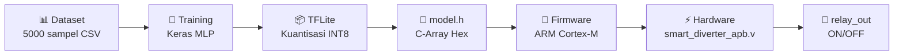

# 🧠 Penjelasan Rinci: Edge AI Smart Load-Diverter

## Daftar Isi
1. [Apa Itu Sistem Ini?](#apa-itu-sistem-ini)
2. [Analogi Sederhana](#analogi-sederhana)
3. [Arsitektur Neural Network](#arsitektur-neural-network)
4. [Penjelasan Tiap Modul](#penjelasan-tiap-modul)
5. [Alur Data End-to-End](#alur-data-end-to-end)
6. [Cara Validasi Langsung](#cara-validasi-langsung)

---

## Apa Itu Sistem Ini?

Sistem ini adalah **otak buatan (AI)** yang ditanamkan ke **chip mikrokontroler** (ARM Cortex-M) untuk mengambil keputusan secara otomatis:

> **"Apakah kelebihan listrik dari panel surya harus dialihkan ke toren air / water heater, atau dibiarkan normal?"**

Kenapa ini penting? Karena jika kelebihan energi surya tidak dialihkan, energi tersebut akan "bocor" ke jaringan PLN — ini disebut *Grid-Defection curtailment*, sesuatu yang ingin kita hindari.

### Kenapa Pakai AI, Bukan If-Else Biasa?

Bisa saja pakai if-else sederhana seperti:
```python
if daya_surya > 500 and toren < 85:
    alihkan()
```

Tapi AI punya kelebihan:
- **Menangkap pola non-linear** — kombinasi jam + cuaca + daya + toren + suhu secara bersamaan
- **Memberikan probabilitas** — bukan hanya "ya/tidak", tapi "seberapa yakin" (misal 92% yakin harus alihkan)
- **Adaptif** — bisa dilatih ulang jika pola berubah
- **Proof of concept** — menunjukkan kemampuan teknis tim untuk proposal

---

## Analogi Sederhana

Bayangkan AI ini seperti **seorang petugas PDAM** yang mengawasi panel surya:

```
☀️ Panel Surya menghasilkan listrik
         │
         ▼
    ┌─────────┐
    │  🧠 AI  │  ← "Petugas" melihat 5 hal:
    │  (Otak) │     1. Jam berapa sekarang?
    │         │     2. Cuaca bagaimana?
    │         │     3. Berapa watt yang dihasilkan?
    │         │     4. Toren masih ada ruang?
    │         │     5. Heater sudah panas?
    └────┬────┘
         │
    ┌────┴────┐
    │Keputusan│
    └────┬────┘
         │
    ┌────┴─────────────┐
    │                  │
  "Alihkan!"      "Biarkan"
  relay ON         relay OFF
  (isi toren)     (normal)
```

---

## Arsitektur Neural Network

### Struktur Layer

```
INPUT (5 sensor)          HIDDEN LAYER 1      HIDDEN LAYER 2      OUTPUT
                          (8 neuron, ReLU)    (4 neuron, ReLU)    (1 neuron, Sigmoid)

 jam ──────────┐
               ├──→ [N1]─┐
 cuaca ────────┤    [N2] ├──→ [N1]─┐
               ├──→ [N3] │    [N2] ├──→ Probabilitas (0.0 - 1.0)
 daya_surya ───┤    [N4] ├──→ [N3] │
               ├──→ [N5] │    [N4]─┘
 toren_persen ─┤    [N6]─┘
               ├──→ [N7]
 suhu_heater ──┘    [N8]
```

### Penjelasan Tiap Bagian

| Komponen | Penjelasan |
|----------|-----------|
| **Input Layer (5 neuron)** | Menerima 5 data sensor yang sudah dinormalisasi ke rentang 0-1 |
| **Hidden Layer 1 (8 neuron, ReLU)** | Mencari pola dasar dari kombinasi sensor. ReLU = jika nilai < 0, jadikan 0; jika ≥ 0, biarkan. Ini membuat komputasi sangat cepat di chip |
| **Hidden Layer 2 (4 neuron, ReLU)** | Menyederhanakan pola menjadi representasi yang lebih ringkas |
| **Output Layer (1 neuron, Sigmoid)** | Menghasilkan angka 0.0 sampai 1.0 = **probabilitas**. Contoh: 0.92 berarti "92% yakin harus alihkan" |

### Apa Itu Normalisasi?

Sebelum masuk ke AI, data sensor harus dinormalisasi ke rentang [0, 1]:

```
                     nilai - minimum
normalisasi = ────────────────────────
               maximum - minimum

Contoh: jam = 12.0
        normalisasi = (12 - 6) / (18 - 6) = 6/12 = 0.5
```

Ini diperlukan karena kalau tidak, fitur dengan angka besar (daya_surya: 0-2500) akan mendominasi fitur dengan angka kecil (cuaca: 0-2).

---

## Penjelasan Tiap Modul

### 📊 Modul 1: `generate_dataset.py` — Dataset Sintetis

**Tujuan:** Membuat "buku pelajaran" untuk AI. Karena kita tidak punya data sensor nyata berbulan-bulan, kita buat data sintetis yang **logis secara fisika**.

**Apa yang dilakukan:**
```
1. Bangkitkan 5000 baris data acak tapi realistis
2. Setiap baris punya 5 fitur (input) dan 1 label (output)
3. Label ditentukan oleh logika fisika:
   - Daya surya melimpah (>500W) DAN
   - Penyimpanan belum penuh (toren<85% ATAU heater<70°C)
   → Label = 1 (Alihkan)
4. Tambahkan 3% noise (label yang sengaja "salah") supaya realistis
```

**Hubungan fisika yang dimodelkan:**
- Daya surya tergantung **jam** (puncak jam 12) dan **cuaca** (cerah > mendung > hujan)
- Ini dimodelkan dengan distribusi Gaussian yang dipusatkan di jam 12

**Output:** [`dummy_energy_data.csv`](file:///c:/edgeai_seno/output/dummy_energy_data.csv) — 5000 baris data training

---

### 🧠 Modul 2: `train_model.py` — Pelatihan Neural Network

**Tujuan:** Mengajari AI mengenali pola dari dataset. Seperti guru mengajari murid dari buku pelajaran.

**Apa yang dilakukan:**
```
1. LOAD    → Baca CSV dataset
2. SPLIT   → Bagi data: 68% training, 17% validasi, 15% testing
3. SCALE   → Normalisasi semua fitur ke [0, 1] pakai MinMaxScaler
4. BUILD   → Bangun arsitektur: Input(5) → Dense(8,ReLU) → Dense(4,ReLU) → Dense(1,Sigmoid)
5. TRAIN   → Latih model 100 epoch, batch_size=32, optimizer=Adam
6. EVAL    → Evaluasi di test set → akurasi, precision, recall, F1
7. PLOT    → Buat grafik Loss & Accuracy
8. SAVE    → Simpan model (.keras) dan scaler (.pkl)
```

**Istilah penting:**

| Istilah | Penjelasan |
|---------|-----------|
| **Epoch** | 1 kali AI melihat SELURUH dataset. 100 epoch = 100 kali belajar |
| **Batch** | AI tidak belajar satu-satu, tapi per kelompok 32 sampel |
| **Loss** | "Seberapa salah" prediksi AI. Makin kecil makin bagus |
| **Accuracy** | Persentase prediksi benar |
| **Early Stopping** | Jika AI tidak membaik selama 15 epoch, berhenti (mencegah overfitting) |
| **Overfitting** | AI terlalu "hafal" data training tapi gagal di data baru |
| **Adam Optimizer** | Algoritma yang mengatur seberapa besar AI mengkoreksi dirinya tiap langkah |

**Output:**
- `smart_diverter_model.keras` — model AI yang sudah terlatih
- `scaler.pkl` — parameter normalisasi (min/max tiap fitur)
- `training_history.png` — grafik bukti training stabil
- `training_metrics.json` — angka-angka evaluasi

---

### 📦 Modul 3: `convert_to_tflite.py` — Kuantisasi TFLite

**Tujuan:** Membuat AI-nya "kurus" supaya muat di chip mikrokontroler yang memorinya sangat terbatas.

**Masalah:** Model Keras menyimpan bobot sebagai angka 32-bit float (misal: `0.123456789`). Di mikrokontroler dengan RAM 64KB, ini terlalu boros.

**Solusi — Kuantisasi:**
```
SEBELUM (Float32):  0.123456789  → 4 bytes per angka
SESUDAH (INT8):     31           → 1 byte per angka (dipetakan ke rentang -128..127)

Kompresi: ~4x lebih kecil!
```

**Proses detail:**
```
1. FLOAT CONVERSION   → Konversi Keras → TFLite Float32 (baseline, 2.76 KB)
2. REPRESENTATIVE DATA → Ambil 200 sampel data sebagai "kalibrasi"
3. INT8 QUANTIZATION  → Konversi Float32 → INT8 dengan kalibrasi (3.53 KB)
4. VALIDATE           → Bandingkan akurasi Float32 vs INT8
                         Float32: 94.78%  vs  INT8: 94.84%
                         → Tidak ada penurunan! ✅
```

> [!NOTE]
> Kenapa INT8 bisa tetap akurat? Karena model kita sangat kecil (hanya 89 parameter). Pada model besar, kuantisasi bisa menurunkan akurasi 1-2%.

**Output:** [`smart_diverter.tflite`](file:///c:/edgeai_seno/output/model/smart_diverter.tflite) — file biner 3.53 KB siap masuk chip

---

### 🔧 Modul 4: `generate_c_header.py` — C-Byte Array Header

**Tujuan:** Menerjemahkan file `.tflite` menjadi bahasa yang dimengerti oleh firmware mikrokontroler (bahasa C).

**Masalah:** Mikrokontroler tidak punya filesystem seperti komputer. Tidak bisa `open("model.tflite")`. Model harus "ditempel" langsung di dalam kode program.

**Solusi:**
```c
// File model.h — model AI dalam bentuk array angka hexadecimal
const unsigned char smart_diverter_tflite[] = {
    0x20, 0x00, 0x00, 0x00, 0x54, 0x46, 0x4c, 0x33,  // byte 0-7
    0x14, 0x00, 0x20, 0x00, 0x1c, 0x00, 0x18, 0x00,  // byte 8-15
    // ... ribuan byte lainnya ...
};
const unsigned int smart_diverter_tflite_len = 3528;  // ukuran total
```

**Tambahan penting di model.h:**
```c
// Macro untuk konversi probabilitas AI → nilai threshold register
#define PROB_TO_THRESHOLD(prob) \
    (3000 - (unsigned int)((prob) * (3000 - 1000)))

// Contoh: probabilitas 0.90 → threshold = 3000 - (0.9 * 2000) = 1200W
// Artinya: relay akan ON jika arus surya > 1200W
```

**Output:** [`model.h`](file:///c:/edgeai_seno/output/model/model.h) — file C header siap compile

---

### 🎮 Modul 5: `inference_demo.py` — Demo Inferensi

**Tujuan:** Membuktikan bahwa AI benar-benar bekerja dengan skenario nyata.

**Apa yang dilakukan:**
```
1. Load model TFLite yang sudah dikuantisasi
2. Simulasikan 8 skenario berbeda:
   - Cerah + toren kosong     → harus ALIHKAN ✅
   - Hujan + produksi rendah  → harus NORMAL ✅
   - Storage penuh            → harus NORMAL ✅
   - Boundary case            → AI harus memutuskan
3. Untuk setiap skenario:
   a. Normalisasi input
   b. Jalankan inferensi TFLite
   c. Hitung probabilitas
   d. Konversi ke threshold register
   e. Simulasikan APB write ke hardware
```

**Output:** [`inference_demo_results.json`](file:///c:/edgeai_seno/output/inference_demo_results.json) — hasil prediksi 8 skenario

---

### 💾 `firmware_example.c` — Contoh Firmware

**Tujuan:** Menunjukkan bagaimana AI ini akan berjalan di dalam chip ARM Cortex yang sesungguhnya.

**Alur di firmware:**
```
┌──────────────────────────────────────────────┐
│             LOOP UTAMA FIRMWARE              │
│                                              │
│  1. Baca sensor (ADC/I2C)                    │
│     jam=12.0, cuaca=2, daya=1500W, dll       │
│                                              │
│  2. Normalisasi ke [0,1]                     │
│     [0.5, 1.0, 0.6, 0.45, 0.23]             │
│                                              │
│  3. Jalankan Neural Network                  │
│     interpreter.Invoke()                     │
│     → probability = 0.92                     │
│                                              │
│  4. Hitung threshold                         │
│     threshold = 3000 - (0.92 × 2000) = 1160W│
│                                              │
│  5. Tulis ke hardware register               │
│     WRITE_THRESHOLD(1160)                    │
│     → APB bus: PADDR=0x08, PWDATA=1160       │
│                                              │
│  6. IP Core Verilog otomatis:                │
│     if (arus_surya > 1160) relay_out = 1     │
│                                              │
│  7. Tunggu 1 detik, ulangi                   │
└──────────────────────────────────────────────┘
```

---

## Alur Data End-to-End



---

## Cara Validasi Langsung

Berikut cara kamu bisa langsung memvalidasi bahwa AI ini bekerja.

### Validasi 1: Jalankan Ulang Seluruh Pipeline

```bash
# Dari terminal, di folder c:\edgeai_seno
C:\edgeai_seno\.python\python.exe run_pipeline.py
```
Pastikan semua 5 step menampilkan ✅ BERHASIL.

### Validasi 2: Cek Dataset yang Dihasilkan

```bash
# Lihat 5 baris pertama dataset
C:\edgeai_seno\.python\python.exe -c "import pandas as pd; df=pd.read_csv('output/dummy_energy_data.csv'); print(df.head()); print(f'\nTotal: {len(df)} baris'); print(df.describe())"
```

### Validasi 3: Cek Akurasi Model

```bash
# Baca metrik dari file JSON
C:\edgeai_seno\.python\python.exe -c "import json; m=json.load(open('output/training_metrics.json')); print(f'Akurasi: {m[\"test_accuracy\"]*100:.2f}%'); print(f'F1-Score: {m[\"f1_score\"]:.4f}'); print(f'Confusion Matrix: {m[\"confusion_matrix\"]}')"
```

### Validasi 4: Test Prediksi Manual dengan Skenario Kustom

```bash
# Jalankan inferensi interaktif — kamu masukkan data sensor sendiri
C:\edgeai_seno\.python\python.exe inference_demo.py --interactive
```
Kamu akan diminta memasukkan:
- Jam (6-18)
- Cuaca (0/1/2)
- Daya surya (Watt)
- Toren (%)
- Suhu heater (°C)

Lalu AI akan memberikan prediksi!

### Validasi 5: Cek Ukuran Model TFLite

```bash
# Pastikan model cukup kecil untuk mikrokontroler
C:\edgeai_seno\.python\python.exe -c "import os; size=os.path.getsize('output/model/smart_diverter.tflite'); print(f'Ukuran model: {size} bytes ({size/1024:.2f} KB)'); print('✅ Muat di ARM Cortex!' if size < 50000 else '❌ Terlalu besar')"
```

### Validasi 6: Verifikasi model.h Cocok dengan .tflite

```bash
# Pastikan C-header benar (byte-nya cocok)
C:\edgeai_seno\.python\python.exe -c "
import re
with open('output/model/smart_diverter.tflite','rb') as f: orig=f.read()
with open('output/model/model.h','r') as f: header=f.read()
hexes=re.findall(r'0x([0-9a-f]{2})',header)
extracted=bytes([int(h,16) for h in hexes])
print(f'TFLite: {len(orig)} bytes')
print(f'Header: {len(extracted)} bytes')
print('✅ COCOK!' if orig==extracted else '❌ TIDAK COCOK')
"
```

### Validasi 7: Test Logika AI — Apakah Masuk Akal?

```bash
C:\edgeai_seno\.python\python.exe -c "
import os, sys, pickle, numpy as np
os.environ['TF_CPP_MIN_LOG_LEVEL']='3'
import tensorflow as tf

interpreter = tf.lite.Interpreter(model_path='output/model/smart_diverter.tflite')
interpreter.allocate_tensors()
inp = interpreter.get_input_details()
out = interpreter.get_output_details()

with open('output/model/scaler.pkl','rb') as f: scaler=pickle.load(f)

tests = [
    ('Siang cerah, daya tinggi, toren kosong', [12.0, 2, 1800, 20, 35]),
    ('Hujan, daya rendah',                      [8.0,  0, 100,  30, 40]),
    ('Cerah tapi storage penuh',                [12.0, 2, 1600, 95, 85]),
]

for desc, raw in tests:
    x = scaler.transform([raw]).astype(np.float32)
    interpreter.set_tensor(inp[0]['index'], x)
    interpreter.invoke()
    prob = interpreter.get_tensor(out[0]['index'])[0][0]
    keputusan = '🔴 ALIHKAN' if prob >= 0.5 else '🟢 NORMAL'
    print(f'{desc}')
    print(f'  → Probabilitas: {prob:.2%} → {keputusan}')
    print()
"
```

**Hasil yang diharapkan:**
- Siang cerah + toren kosong → **🔴 ALIHKAN** (probabilitas tinggi) ✅
- Hujan + daya rendah → **🟢 NORMAL** (probabilitas rendah) ✅  
- Storage penuh → **🟢 NORMAL** (walaupun daya tinggi) ✅

Jika ketiga hasil ini benar, berarti **AI sudah belajar logika fisika dengan benar!**
